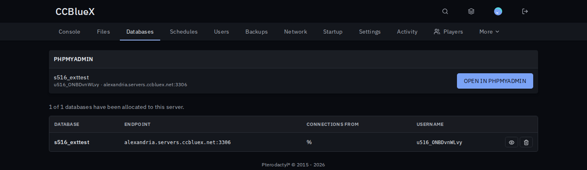
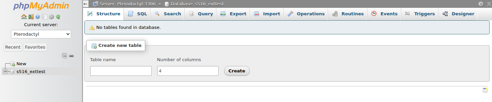

# phpMyAdmin for Pterodactyl

Open server databases in phpMyAdmin with one click, without copying passwords.

## Install

1. Download `phpmyadmin-<version>.pteroext` from the [latest release](https://github.com/1zun4/Pterodactyl-Extension-phpMyAdmin/releases/latest), then install and enable it under **Admin → Extensions**.
2. Copy [`contrib/phpmyadmin/signon.php`](contrib/phpmyadmin/signon.php) next to phpMyAdmin's `index.php`, add the server from [`config.inc.php.example`](contrib/phpmyadmin/config.inc.php.example) and fill in the panel URL and a secret.
3. Open the extension's settings and enter the `signon.php` URL and the same secret.

## Features

- **One click**: an "Open in phpMyAdmin" button for every database on the server's Databases page.
- **No passwords copied**: the panel hands phpMyAdmin a link that works once and expires after a minute.
- **Right permissions**: only users who may see the database password get the button.
- **Locked to the database**: phpMyAdmin only shows the server's own database.

## Settings

| Setting | What it does |
| --- | --- |
| signon.php URL | Where you placed `signon.php`. |
| Shared secret | Must match `$secret` in `signon.php`. |
| Database host for phpMyAdmin | Use this when phpMyAdmin reaches the database host under another address. |
| phpMyAdmin IP addresses | Only these may redeem login links. |

---

Inspired by the Pelican plugin PmaLink.
